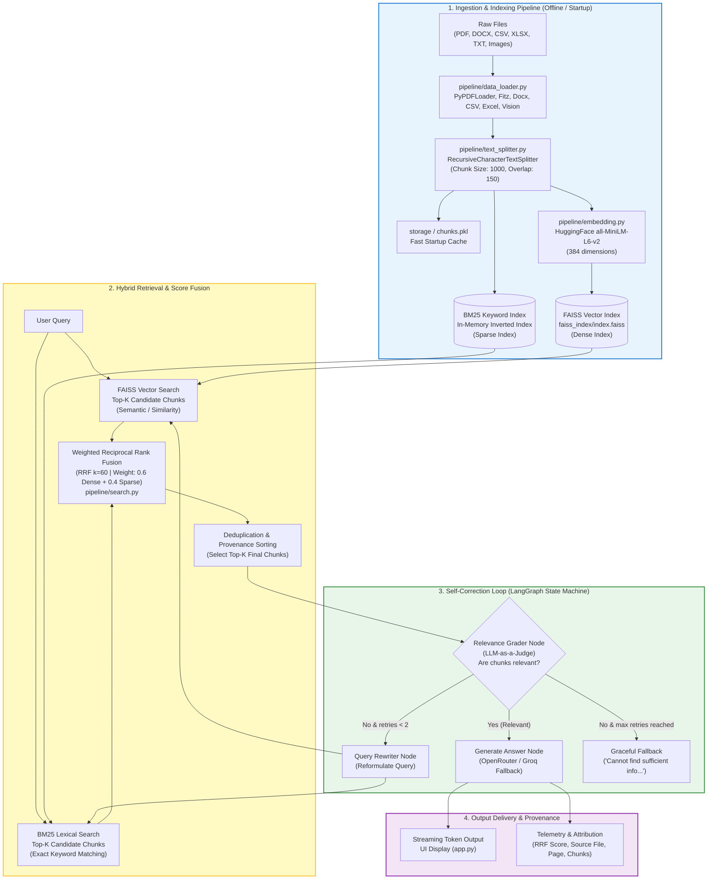

# Hybrid RAG System: Complete Architecture, Working Flow & Interview Master Guide

> **Project Overview:** A production-grade, self-correcting **Hybrid Retrieval-Augmented Generation (RAG)** pipeline combining **Dense Semantic Search (FAISS)** and **Sparse Lexical Search (BM25)** with **Weighted Reciprocal Rank Fusion (RRF)**, **Multimodal Document Processing**, and **Agentic Self-Correction via LangGraph**.

---

## 0. Plain-English Summary & 1-Minute Interview Pitch

### The Core Idea (In One Sentence)
> *"Standard RAG searches either only by meaning or only by exact words. My project combines **both**, and adds a **smart quality inspector** that re-writes the question if the search results aren't good enough before answering."*

### Think of It Like a Library (5 Simple Steps)

```
[1. Cut books into cards] ──> [2. Make 2 catalogs] ──> [3. Search both] ──> [4. Double-check results] ──> [5. Write answer]
```

1. **Step 1: Slice documents into small cards (Chunking & Vision)**
   - You can't feed a 200-page book to an AI all at once. We slice files into small "cards" of ~1,000 characters with a 15% overlap so sentences aren't split in half.
   - **Visual Content:** If a PDF has a chart or graph, PyMuPDF extracts it, a Vision model (Gemma 3 27B) describes it in text, and we save that description as a searchable card.
   - **Tabular Data:** CSV rows are kept atomic so table headers and cells are never separated.

2. **Step 2: Create TWO search catalogs (Dense & Sparse Index)**
   - **Catalog A (Meaning / Vector - FAISS):** Understands synonyms. If you search *"automobile"*, it finds *"car"*.
   - **Catalog B (Exact Words / BM25):** Like `Ctrl + F`. If you search a code or acronym like *"PSK"* or *"Model-90"*, it finds that exact word.

3. **Step 3: Search both catalogs simultaneously (Hybrid Search + RRF)**
   - When a user asks a question, both catalogs are searched at once.
   - Results are combined using **Reciprocal Rank Fusion (RRF)**. If a card appears in *both* searches, it gets boosted to the very top. We pick the top 4 best cards.

4. **Step 4: The Quality Inspector (LangGraph Self-Correction)**
   - Standard RAG blindly answers using whatever it finds—even if it's irrelevant.
   - Here, an AI Inspector tests: *"Do these cards actually contain the answer?"*
   - **If YES:** Proceeds to write the answer.
   - **If NO:** It re-writes the user's question with better synonyms and searches again (retries up to 2 times).
   - If still nothing is found, it safely says: *"I don't have enough info in the documents,"* avoiding hallucinations.

5. **Step 5: Generate the Answer with Exact Citations**
   - The LLM reads only those 4 verified cards and streams the answer with exact source file names and page numbers.
   - If the primary LLM (OpenRouter) is busy or rate-limited, it automatically falls back to Groq without failing.

---

### Why Not Just Dump the Whole PDF into ChatGPT? (Quick Interview Talking Points)
- **"Lost in the Middle" problem:** LLMs with large context windows still forget facts buried in the middle of long texts.
- **Latency & Speed:** Scanning 100 pages takes 10–20 seconds. Reading 4 verified cards takes **under 1 second**.
- **Accuracy:** Less clutter means fewer hallucinations.

---

### The 1-Minute Spoken Script (Word-for-Word for Interviews)
> *"Sure! My project is a Hybrid RAG system built in 5 clean stages:*
> 
> *First, we take documents like PDFs and Excel sheets, slice them into small paragraphs, and convert any charts or images into text using a vision model.*
> 
> *Second, we store them in two indexes: a **Vector index** to search by meaning, and a **BM25 keyword index** to search for exact words and acronyms.*
> 
> *Third, when a question is asked, we run both searches and combine the top results using **Rank Fusion** so we get the best of both worlds.*
> 
> *Fourth, before answering, we have a **self-correcting check** using LangGraph. If the retrieved paragraphs aren't relevant, the system re-writes the question and tries the search again.*
> 
> *Finally, the AI uses only the verified paragraphs to generate the answer with exact source citations, with an automatic backup model in place if the main AI is rate-limited."*

---

## 1. High-Level Flow & Architectural Overview

Traditional RAG relies solely on vector similarity (dense retrieval), which regularly fails when searching for exact part numbers, domain acronyms, or specific keyword queries. Conversely, pure keyword search (BM25) misses semantic nuances and synonyms.

This system combines both paradigms into a **Hybrid Architecture** and adds an **Agentic Self-Correction Loop** using LangGraph to evaluate retrieved context quality before calling the generator LLM.

### System Architecture Diagram



---

## 2. Step-by-Step Breakdown: What Happens at Each Stage

### Step 1: Multi-Modal Document Ingestion ([data_loader.py](file:///c:/Users/Rutuj%20Dhawale/Desktop/hybrid-rag/pipeline/data_loader.py))
- **Heterogeneous Formats:** Supports `.pdf`, `.docx`, `.xlsx`, `.xls`, `.csv`, `.txt`, and images (`.png`, `.jpg`, `.jpeg`).
- **PDF Text Parsing:** Uses `PyPDFLoader` to extract page-by-page text.
- **Multimodal Visual Extraction:**
  - Extracts embedded charts, diagrams, tables, and images from PDF pages using **PyMuPDF (`fitz`)**.
  - Sends image bytes to **OpenRouter's Gemma 3 27B Vision model** ([vision.py](file:///c:/Users/Rutuj%20Dhawale/Desktop/hybrid-rag/pipeline/vision.py)).
  - The vision model converts images and charts into structured text descriptions: `[Image Context: Chart on page 3] -> Bar chart showing Q3 revenue growth...`.
  - These descriptions are ingested as standard LangChain `Document` objects with metadata tags (`file_type="pdf_image"`), making charts and diagrams searchable through text retrieval.
- **Structured Files:** Loads CSV rows and Excel sheets into individual atomic rows preserving tabular relationships.

---

### Step 2: Intelligent Chunking ([text_splitter.py](file:///c:/Users/Rutuj%20Dhawale/Desktop/hybrid-rag/pipeline/text_splitter.py))
- **Tool:** LangChain's `RecursiveCharacterTextSplitter`.
- **Default Hyperparameters:**
  - `chunk_size = 1000` characters (~200–250 tokens).
  - `chunk_overlap = 150` characters (~15% overlap).
- **Hierarchical Boundary Splitting:**
  The splitter does **not** perform hard cuts. It prioritizes semantic boundaries using separators in order:
  $$\text{Separators} = [\text{"}\backslash n\backslash n\text{"}, \text{"}\backslash n\text{"}, \text{". "}, \text{" "}, \text{""}]$$
  1. Paragraph breaks (`\n\n`)
  2. Single line breaks (`\n`)
  3. Sentence terminators (`. `)
  4. Word spaces (` `)
  5. Character fallback (`""`)
- **Atomic Unit Protection (`NO_SPLIT_FILE_TYPES = {"csv"}`):**
  Tabular CSV records are already atomic. Splitting across an arbitrary 1000-character boundary would tear headers from rows. Therefore, CSV documents bypass the recursive splitter to preserve row context.
- **Metadata Tagging:**
  Each chunk is enriched with:
  `source` (filepath), `file_type`, `page_number`, and `chunk_index` (ordering within the document).

---

### Step 3: Dual Indexing (Dense + Sparse)

```
                            Document Chunks
                                   │
                   ┌───────────────┴───────────────┐
                   ▼                               ▼
       [Embedding Model]                   [BM25 Tokenizer]
   all-MiniLM-L6-v2 (384-d)               Inverted Index
                   │                               │
                   ▼                               ▼
        [FAISS Vector Store]              [In-Memory BM25 Store]
    Saved to disk: index.faiss + index.pkl    Cached in memory & chunks.pkl
```

#### A. Dense Indexing ([vectorstore.py](file:///c:/Users/Rutuj%20Dhawale/Desktop/hybrid-rag/pipeline/vectorstore.py), [embedding.py](file:///c:/Users/Rutuj%20Dhawale/Desktop/hybrid-rag/pipeline/embedding.py))
- **Embedding Model:** `sentence-transformers/all-MiniLM-L6-v2` via HuggingFace Embeddings.
  - Generates dense vector representations of **384 dimensions**.
  - Auto-detects NVIDIA CUDA GPU; falls back cleanly to CPU.
- **Index Engine:** **FAISS (Facebook AI Similarity Search)**.
  - Builds index from document embeddings and persists to disk (`./faiss_index/index.faiss` and metadata file `index.pkl`).
  - Search Metric: Euclidean $L_2$ distance (or Inner Product if normalized).

#### B. Sparse Indexing ([search.py](file:///c:/Users/Rutuj%20Dhawale/Desktop/hybrid-rag/pipeline/search.py))
- **Engine:** `rank_bm25` (BM25Okapi).
- Builds an in-memory inverted index of tokenized chunks.
- Computes Term Frequency (TF) with saturation, Document Length Normalization, and Inverse Document Frequency (IDF).

#### C. Startup Optimization & Chunk Caching ([engine.py](file:///c:/Users/Rutuj%20Dhawale/Desktop/hybrid-rag/core/engine.py))
- Splitting hundreds of pages and generating embeddings is expensive.
- The pipeline writes chunk objects to `faiss_index/chunks.pkl`.
- Upon application restart, `load_existing_pipeline()` loads `index.faiss` and deserializes `chunks.pkl`, rebuilding the in-memory BM25 index in **<100ms** without re-parsing files or calling embedding models.

---

### Step 4: Hybrid Retrieval & Reciprocal Rank Fusion ([search.py](file:///c:/Users/Rutuj%20Dhawale/Desktop/hybrid-rag/pipeline/search.py))

When a user submits a query, parallel retrieval branches execute:
1. **Dense Branch (FAISS):** Fetches Top-$K$ semantic matches by minimizing $L_2$ vector distance:
   $$\text{sim\_score} \approx \frac{1}{1 + \text{dist}_{L2}}$$
2. **Sparse Branch (BM25):** Fetches Top-$K$ keyword matches based on lexical token overlaps.
3. **Score Fusion with Weighted Reciprocal Rank Fusion (RRF):**
   Dense distance scores ($0 \dots \infty$) and BM25 scores ($0 \dots 50+$) exist on entirely different mathematical scales and cannot simply be added together without skewing.
   RRF neutralizes scale discrepancies by operating on **ordinal ranks** rather than raw scores:

$$\text{RRF Score}(d) = \sum_{m \in \{\text{dense, sparse}\}} \frac{w_m}{k + \text{rank}_m(d)}$$

Where:
- $k = 60$ (standard smoothing constant that avoids giving excessive weight to rank 1).
- $w_{\text{dense}} = 0.6$ (semantic weight).
- $w_{\text{sparse}} = 0.4$ (keyword weight).
- $\text{rank}_m(d)$ is the 1-based position of chunk $d$ in retriever $m$'s result list.

4. **Deduplication:**
   Chunks retrieved by both branches are identified via `doc_key = f"{source}::{chunk_index}"`.
   Their reciprocal scores are summed:
   $$\text{Score}_{\text{fused}} = \frac{0.6}{60 + \text{rank}_{\text{vector}}} + \frac{0.4}{60 + \text{rank}_{\text{bm25}}}$$
   Chunks appearing in **both** indices receive a significant ranking boost, reflecting high confidence in both semantic meaning and exact keyword presence.
5. **Telemetry & Provenance:**
   Every document is annotated with its origin (`hybrid_both`, `vector_only`, or `bm25_only`), individual ranks, and final fused score.

---

### Step 5: Self-Corrective Agentic Flow ([graph.py](file:///c:/Users/Rutuj%20Dhawale/Desktop/hybrid-rag/pipeline/graph.py))

Instead of passing retrieved chunks directly to the generator (which leads to hallucinations if chunks are irrelevant), the pipeline routes through a **LangGraph state machine**:

```
[retrieve] ──> [grade_relevance] ──┬──> (is_relevant == True)  ──> [generate] ──> END
                                   │
                                   ├──> (is_relevant == False & retries < 2) ──> [rewrite_query] ──> [retrieve]
                                   │
                                   └──> (is_relevant == False & retries >= 2) ──> [fallback] ──> END
```

1. **`retrieve` Node:** Invokes hybrid retrieval with current `state["question"]`.
2. **`grade_relevance` Node (LLM Evaluator):**
   - Feeds the query and retrieved context chunks to a fast LLM.
   - Evaluates whether the retrieved context contains information capable of answering the question.
   - Outputs a binary verdict: `"yes"` or `"no"`.
3. **Conditional Routing (`route_after_grading`):**
   - **Case A (Relevant):** Transitions immediately to `generate`.
   - **Case B (Irrelevant & retries < 2):** Transitions to `rewrite_query`.
   - **Case C (Irrelevant & retries == 2):** Emits predefined fallback: *"I couldn't find enough relevant information in the provided documents to answer this question confidently..."*
4. **`rewrite_query` Node:**
   - Prompts the LLM: *"The following search query did not retrieve relevant results... Rewrite this query to be clearer, broader, or use different synonyms..."*
   - Increments `retry_count`.
   - Passes reformulated query back into the `retrieve` node.

---

### Step 6: Context Injection & Generation ([llm.py](file:///c:/Users/Rutuj%20Dhawale/Desktop/hybrid-rag/pipeline/llm.py))
- **Dual-Provider Architecture:**
  - **Primary:** OpenRouter (`google/gemma-3-27b-it:free`).
  - **Secondary / Fallback:** Groq (`llama-3.3-70b-versatile` or `openai/gpt-oss-20b`).
  - `call_llm_with_fallback()` automatically catches HTTP errors, timeouts, or rate limits (HTTP 429) from the primary model and retries using the fallback provider seamlessly.
- **Context Construction:**
  Formatted into isolated chunks tagged with provenance:
  ```text
  [Chunk 1 | Source: BlackBook.pdf | Type: pdf]
  Phase Shift Keying (PSK) is a digital modulation method...
  
  [Chunk 2 | Source: Computer Networking.pdf | Type: pdf]
  The constellation diagram represents signal states...
  ```
- **Strict Guardrail Prompt:**
  Instructs the LLM to ground answers exclusively in provided chunks, cite source filenames, state missing aspects explicitly, and avoid confabulation.

---

## 3. The Context Window & Token Management

### What is the Context Window?
The **context window** is the maximum number of tokens an LLM can accept and process across the input prompt and output completion simultaneously.
- E.g., `Gemma 3 27B`: ~128,000 tokens.
- `Llama 3.3 70B`: ~128,000 tokens.

### Why Not Put the Whole Document into the Context Window?
If modern LLMs have 128k+ token windows, why do we need RAG at all?
1. **The "Lost in the Middle" Phenomenon:**
   Empirical research (Liu et al., Stanford) proves that LLM attention mechanisms degrade when handling very long contexts. LLMs reliably recall facts placed at the extreme beginning or end of the context, but frequently overlook facts placed in the middle.
2. **Signal-to-Noise Ratio & Hallucinations:**
   A 300-page book has ~150,000 words. Injecting all of it dilutes the prompt attention weights across irrelevant chapters, increasing hallucination rates.
3. **Latency:**
   Time-To-First-Token (TTFT) scales quadratically/linearly with input context length due to self-attention computation over key-value caches. A 100k-token prompt takes seconds or tens of seconds just to pre-fill.
4. **Cost:**
   API providers charge per input token. Submitting entire books for every single question is economically impractical.

### How this Hybrid RAG System Budgets the Context Window:
- **Chunk Size:** 1000 characters $\approx 200 - 250$ tokens.
- **Top-K Chunks:** 4 chunks $\approx 800 - 1000$ tokens.
- **System Prompt + Instructions:** $\approx 250$ tokens.
- **User Query + History:** $\approx 150$ tokens.
- **Total Input Context:** $\approx 1,400$ tokens.
- **Max Generation Output:** Configured to `2048` tokens.

**Result:** The entire RAG prompt consumes only **~1% to 2%** of the LLM's capacity. By keeping context tight and dense with only relevant information, retrieval precision is high, latency is low (<1s TTFT on Groq), and hallucinations caused by irrelevant context are eliminated.

---

## 4. How Do You Pass *Only* Relevant Chunks?

The system applies a **multi-stage filtering funnel** to ensure only pertinent text reaches the final prompt:

```
[Entire Document Corpus: 10,000+ Chunks]
                   │
                   ▼  Phase 1: High-Recall Retrieval (Top-K = 4 from each)
         FAISS (4 chunks) + BM25 (4 chunks)
                   │
                   ▼  Phase 2: Reciprocal Rank Fusion & Deduplication
         Unique union: 4 to 8 candidates sorted by RRF score
                   │
                   ▼  Phase 3: Hard Top-K Cut
         Top 4 highest scoring chunks selected
                   │
                   ▼  Phase 4: Agentic Relevance Grading (LangGraph)
         LLM-as-a-Judge inspects chunks:
         - Are they relevant to the query?
         - If NO: Rewrites query & re-retrieves
         - If YES: Passes forward
                   │
                   ▼
     [Final Context Passed to LLM: Exactly 4 Verified Chunks]
```

### Mechanisms Guaranteeing Relevance:
1. **Dual Search Complementarity:**
   - If user asks for `"PSK modulation"`, BM25 scores the exact term highly even if the embedding model misplaces it in semantic space.
   - If user asks for `"methods to encode signals on radio carriers"`, FAISS matches the concept to "PSK modulation" even though literal words differ.
2. **Reciprocal Rank Fusion (RRF):**
   - Items scoring high in *both* retrievers get a mathematical boost. An irrelevant chunk returned by one branch due to keyword coincidence is down-ranked if the semantic branch does not support it.
3. **LangGraph Relevance Grader Node:**
   - Acts as a programmatic filter. If the retriever returns noise, the pipeline catches it before generation, attempts a query rewrite, and falls back to a safe answer if retries fail.

---

## 5. How Indexing Works: Deep Dive

### A. How FAISS Vector Indexing Works

```
Raw Chunk: "PSK alters the phase of the carrier wave..."
                           │
                           ▼ [Embedding Model: all-MiniLM-L6-v2]
Vector: [0.034, -0.129, 0.884, ..., -0.042] (Dimension: 384)
                           │
                           ▼
                    FAISS Index FlatL2
┌─────────────────────────────────────────────────────────────┐
│  Vector ID 0  ──> [ 0.034, -0.129, ... ]                     │
│  Vector ID 1  ──> [-0.012,  0.441, ... ]                     │
│  Vector ID 2  ──> [ 0.198, -0.003, ... ]                     │
└─────────────────────────────────────────────────────────────┘
                           │
 Query Vector: [0.031, -0.120, 0.871, ...]
 Euclidean Distance Calculation: d(q, v) = sqrt(sum((q_i - v_i)^2))
 Returns IDs with minimum distance (closest in geometric space)
```

- **Vector Space Embedding:** Text is projected into a 384-dimensional continuous vector space where semantically similar texts are clustered close together.
- **Indexing Structure:**
  - In this project, `FAISS.from_documents` builds an `IndexFlatL2` (exact exhaustive search calculating Euclidean distance across all vectors).
  - For millions of vectors, FAISS supports `IndexIVFFlat` (Inverted File index using Voronoi cells) or `IndexHNSW` (Hierarchical Navigable Small World graphs) for approximate nearest neighbor (ANN) search.
- **Persistence:**
  FAISS saves two files to disk via `save_local()`:
  - `index.faiss`: Binary matrix of vector coordinates and index structure.
  - `index.pkl`: Serialized Python mapping linking internal FAISS integer IDs to LangChain `Document` objects and metadata.

---

### B. How BM25 (Sparse) Indexing Works

BM25 (Best Matching 25) is an information retrieval algorithm based on probabilistic relevance:

1. **Inverted Index Construction:**
   The text is tokenized into words (stemmed, lowercased, punctuation removed).
   An inverted index maps every term to a posting list of documents containing it:
   ```text
   "modulation" ──> [Doc 1 (tf=3), Doc 4 (tf=1), Doc 12 (tf=5)]
   "carrier"    ──> [Doc 1 (tf=2), Doc 2 (tf=1)]
   ```

2. **Scoring Function:**
   Given query $Q$ with terms $q_1, \dots, q_n$, the score for document $D$ is:

$$\text{Score}_{\text{BM25}}(D, Q) = \sum_{i=1}^n \text{IDF}(q_i) \cdot \frac{f(q_i, D) \cdot (k_1 + 1)}{f(q_i, D) + k_1 \cdot \left(1 - b + b \cdot \frac{|D|}{\text{avgdl}}\right)}$$

   - $f(q_i, D)$: Term frequency of $q_i$ in document $D$.
   - $|D| / \text{avgdl}$: Document length divided by average document length in the corpus (penalizes long documents with bloated term counts).
   - $k_1$ (typically $1.2 - 2.0$): Term frequency saturation parameter (prevents a document mentioning a word 50 times from scoring 50x higher than one mentioning it 3 times).
   - $b$ (typically $0.75$): Length normalization weight.
   - $\text{IDF}(q_i) = \ln \left( \frac{N - n(q_i) + 0.5}{n(q_i) + 0.5} + 1 \right)$: Inverse document frequency (down-weights common words like "the", "system"; up-weights rare terms like "OFDM").

---

## 6. Interview Questions & Comprehensive Answers

### Section 1: Core Concepts & Fundamentals

#### Q1: What is the fundamental difference between Naive RAG, Advanced RAG, and Agentic RAG? Which one does this project implement?
**Answer:**
- **Naive RAG:** Simple linear sequence: *Load $\rightarrow$ Chunk $\rightarrow$ Vector Search $\rightarrow$ Pass Top-K to LLM*. Has no keyword search, no relevance validation, no self-healing, and no retry logic.
- **Advanced RAG:** Adds pre-retrieval techniques (query expansion, hybrid dense+sparse search) and post-retrieval techniques (re-ranking, contextual compression).
- **Agentic RAG:** Treats retrieval as a dynamic graph or tool used by an agent. Evaluates retrieved context, decides whether to generate or rewrite queries, and loops until criteria are satisfied.
- **This Project:** Implements **Advanced RAG + Agentic RAG**. It uses Hybrid Dense-Sparse Retrieval with RRF (Advanced) wrapped in a **LangGraph state machine** with an LLM Relevance Grader and Query Rewriter (Agentic).

#### Q2: Why is Hybrid RAG superior to pure Vector RAG in enterprise environments?
**Answer:**
Pure Vector Search maps text to high-dimensional embeddings. It suffers from three major failure modes:
1. **Out-of-Vocabulary (OOV) & Acronyms:** Industry-specific terms, error codes (e.g., `ERR_0x80070005`), or product codes (`SKU-9921`) often get broken into unrelated sub-word tokens by tokenizer models, producing poor vector matches.
2. **Exact Entity Disambiguation:** Differentiating between "Model A-12" and "Model A-13" requires exact string matching. Embeddings often cluster them virtually identically.
3. **Short Keyword Queries:** Queries consisting of 1–2 words lack semantic context for vector search, whereas BM25 excels at them.
Hybrid RAG fuses BM25 (addressing lexical exactness) with FAISS (addressing semantic synonyms), eliminating these failure modes.

#### Q3: What is Chunk Overlap, why is it necessary, and what happens if it is set incorrectly?
**Answer:**
- **What it is:** The number of characters/tokens shared between consecutive chunks ($150$ characters in this project, $\approx 15\%$).
- **Why it is necessary:** When a document is segmented, semantic thoughts or sentences frequently get severed at chunk boundaries. For example, if a key sentence starts at character 990 and ends at character 1050, splitting at character 1000 cuts the sentence in half. Neither chunk contains the complete proposition.
- **If set to 0:** Information across chunk borders is permanently lost, leading to retrieval misses.
- **If set too high (>50%):** Vector store index size inflates, retrieval returns redundant overlapping duplicate passages, and context window space is wasted.

---

### Section 2: Retrieval, Fusion & Ranking

#### Q4: Why use Reciprocal Rank Fusion (RRF) instead of Linear Weighted Combination (e.g., $0.6 \times \text{FAISS} + 0.4 \times \text{BM25}$)?
**Answer:**
- **The Scale Incompatibility Problem:** FAISS $L_2$ distance ranges from $0$ to $\infty$ (or similarity $0 \dots 1$). BM25 scores are unbounded positive numbers ($0 \dots 50+$) dependent on document length and term frequency. They cannot be summed directly without extensive Min-Max normalization.
- **Min-Max Normalization Flaw:** Outlier scores in a single query distort min-max bounds, causing one retriever to dominate arbitrarily.
- **Why RRF Wins:**
  $$\text{RRF Score}(d) = \sum \frac{w}{k + \text{rank}}$$
  RRF relies purely on **ordinal position** (Rank 1, Rank 2, Rank 3). It is completely immune to score scale divergence, requires no normalizers, and provides robust mathematical guarantees that documents ranked high by multiple retrievers win out.

#### Q5: What is the purpose of the constant $k=60$ in the RRF formula?
**Answer:**
The constant $k$ (typically set to 60, introduced by Cormack et al.) is a **rank smoothing parameter**:
- If $k=0$, Rank 1 scores $\frac{1}{1} = 1.0$, while Rank 2 scores $\frac{1}{2} = 0.5$ (a 50% drop). This would over-penalize lower-ranked documents.
- With $k=60$, Rank 1 scores $\frac{1}{61} \approx 0.01639$, and Rank 2 scores $\frac{1}{62} \approx 0.01612$. The curve is smoothed, ensuring that being ranked 1st in one retriever does not completely overpower a document that was ranked 2nd in both retrievers.

---

### Section 3: Agentic Flows & LangGraph

#### Q6: How does LangGraph handle cycles, and how does your architecture prevent infinite loops during query rewriting?
**Answer:**
- LangGraph supports cyclic computational graphs via directed conditional edges (`add_conditional_edges`).
- In this pipeline: `retrieve -> grade_relevance -> [route_after_grading] -> rewrite_query -> retrieve`.
- **Preventing Infinite Loops:**
  The graph state tracks an integer counter: `state["retry_count"]`.
  When `grade_relevance` marks context as irrelevant, `route_after_grading` inspects `state["retry_count"] < MAX_RETRIES` (configured to 2).
  If `retry_count >= 2`, routing bypasses `rewrite_query` and forces a transition to `generate` with a predefined graceful fallback message. This guarantees execution terminates within deterministic step limits.

#### Q7: Why use an LLM Grader instead of cosine similarity thresholding to filter retrieved chunks?
**Answer:**
- **Vector Cosine Similarity is a Poor Proxy for Answerability:** A document chunk can have high cosine similarity (0.85) because it discusses the same broad topic, yet still lack the specific fact or answer requested by the user.
- **LLM Grader Capabilities:** The LLM inspects the semantic relationship between the *specific question* and the *extracted facts*, determining whether the information is actually sufficient to formulate an answer.
- **Failure Resilience:** In `pipeline/graph.py`, the grader call is wrapped in a `try...except` fallback: if the grading LLM times out or errors, it defaults to `is_relevant = True` to avoid blocking the pipeline.

---

### Section 4: Multimodal Processing & Data Ingestion

#### Q8: How does this project handle images and charts inside PDF files?
**Answer:**
Standard text parsers ignore images, diagrams, and charts. This project implements a multimodal extraction pipeline:
1. `data_loader.py` uses `PyMuPDF` (`fitz`) to extract raw image bytes from PDF pages.
2. In `vision.py`, extracted image bytes are encoded into base64 and sent to OpenRouter's vision model (`google/gemma-3-27b-it:free`).
3. The model generates a descriptive textual synthesis of the visual information (e.g., axes, trends, values in a chart).
4. This textual description is wrapped in a LangChain `Document` with metadata `{"file_type": "pdf_image", "page": page_number}` and ingested into the FAISS and BM25 indices.
5. Consequently, visual knowledge is retrievable using standard natural language queries.

#### Q9: Why are CSV files exempted from chunk splitting (`NO_SPLIT_FILE_TYPES = {"csv"}`)?
**Answer:**
In structured tabular data (CSV/Excel), a single row represents an atomic relational tuple (e.g., `ProductID, Price, Quantity, Status`).
If a standard character splitter splits text at character 1000, it can cut through the middle of a row or separate rows from their table headers. Without the column headers, individual rows become unintelligible strings of numbers. Keeping each record intact preserves row-level context.

---

### Section 5: Evaluation & Production Engineering

#### Q10: How do you evaluate the performance of a RAG pipeline? What metrics matter?
**Answer:**
RAG evaluation is divided into two distinct dimensions:

```
                      [RAG Pipeline Evaluation]
                                  │
          ┌───────────────────────┴───────────────────────┐
          ▼                                               ▼
[Retrieval Metrics]                             [Generation Metrics]
(IR / Search Engine)                            (RAG Triad)
- Hit Rate @ K                                  - Context Relevance
- Mean Reciprocal Rank (MRR)                    - Faithfulness / Groundedness
- NDCG @ K                                      - Answer Relevance
- Precision & Recall @ K
```

1. **Retrieval Metrics (evaluated in `evaluation/eval_retrieval.py`):**
   - **Hit Rate @ K:** Percentage of queries where the ground-truth document was present in the top $K$ retrieved chunks.
   - **MRR (Mean Reciprocal Rank):** Evaluates where the first relevant result appears ($\frac{1}{\text{rank}}$).
   - **NDCG @ K:** Evaluates whether more relevant chunks are ranked above less relevant chunks.
2. **Generation Metrics (RAG Triad via Ragas/TruLens):**
   - **Context Relevance:** Are retrieved chunks free of noise and directly applicable to the query?
   - **Faithfulness (Groundedness):** Can every claim in the LLM's generated response be mathematically traced back to the context chunks? (Zero hallucination test).
   - **Answer Relevance:** Does the generated output actually address the user's intent?

#### Q11: How does this system handle LLM API rate limits, timeouts, and outages in production?
**Answer:**
The system implements a **Dual-Provider Auto-Fallback Architecture** in `pipeline/llm.py`:
- **Primary Provider:** OpenRouter (accessing `google/gemma-3-27b-it:free`).
- **Secondary Provider:** Groq (accessing `llama-3.3-70b-versatile` or `openai/gpt-oss-20b`).
- **Mechanism:** In `call_llm_with_fallback()`, the primary provider is called inside a `try...except` block. If OpenRouter throws a `429 Rate Limit`, timeout, or HTTP 500 error, execution transfers instantly to Groq without crashing the user session.
- **Resource Caching:** The Streamlit orchestration layer (`engine.py`) uses `@st.cache_resource` for the embedding model and LLM clients, ensuring heavyweight neural networks are loaded only once during the application lifecycle.

---

## 7. Key Configuration & Hyperparameters Cheat Sheet

| Parameter | Default Value | Location | Engineering Justification |
|---|---|---|---|
| `chunk_size` | `1000` chars | [config.py](file:///c:/Users/Rutuj%20Dhawale/Desktop/hybrid-rag/core/config.py) | Balances semantic completeness and precision without diluting embeddings. |
| `chunk_overlap` | `150` chars | [config.py](file:///c:/Users/Rutuj%20Dhawale/Desktop/hybrid-rag/core/config.py) | 15% overlap prevents cutting sentences across chunk boundaries. |
| `top_k` | `4` chunks | [config.py](file:///c:/Users/Rutuj%20Dhawale/Desktop/hybrid-rag/core/config.py) | Supplies ~1,000 tokens of high-density context, keeping prompt latency low. |
| `semantic_weight` | `0.6` | [config.py](file:///c:/Users/Rutuj%20Dhawale/Desktop/hybrid-rag/core/config.py) | Gives slight priority to conceptual/semantic intent over exact keyword matches. |
| `keyword_weight` | `0.4` | [config.py](file:///c:/Users/Rutuj%20Dhawale/Desktop/hybrid-rag/core/config.py) | Retains strong influence for exact entity matches, acronyms, and codes. |
| `rrf_k` | `60` | [search.py](file:///c:/Users/Rutuj%20Dhawale/Desktop/hybrid-rag/pipeline/search.py) | Industry-standard smoothing constant preventing rank-1 dominance in fusion. |
| `max_retries` | `2` | [config.py](file:///c:/Users/Rutuj%20Dhawale/Desktop/hybrid-rag/core/config.py) | Bounds LangGraph self-correction to avoid infinite loops and high API costs. |
| `temperature` | `0.2` | [config.py](file:///c:/Users/Rutuj%20Dhawale/Desktop/hybrid-rag/core/config.py) | Low temperature minimizes creative variance and maximizes factual grounding. |
| `embedding_model` | `all-MiniLM-L6-v2` | [embedding.py](file:///c:/Users/Rutuj%20Dhawale/Desktop/hybrid-rag/pipeline/embedding.py) | 384 dimensions; fast, lightweight inference on CPU and GPU. |

---

## 8. Summary File Map

- [pipeline/data_loader.py](file:///c:/Users/Rutuj%20Dhawale/Desktop/hybrid-rag/pipeline/data_loader.py): Multi-format parsing, PyMuPDF chart extraction, vision integration.
- [pipeline/text_splitter.py](file:///c:/Users/Rutuj%20Dhawale/Desktop/hybrid-rag/pipeline/text_splitter.py): Recursive hierarchical chunking and CSV atomic unit protection.
- [pipeline/embedding.py](file:///c:/Users/Rutuj%20Dhawale/Desktop/hybrid-rag/pipeline/embedding.py): HuggingFace embedding wrapper with CUDA GPU auto-detection.
- [pipeline/vectorstore.py](file:///c:/Users/Rutuj%20Dhawale/Desktop/hybrid-rag/pipeline/vectorstore.py): FAISS dense vector store creation, disk persistence, and indexing.
- [pipeline/search.py](file:///c:/Users/Rutuj%20Dhawale/Desktop/hybrid-rag/pipeline/search.py): BM25 inverted index builder, dense-sparse search, and Weighted RRF fusion.
- [pipeline/graph.py](file:///c:/Users/Rutuj%20Dhawale/Desktop/hybrid-rag/pipeline/graph.py): LangGraph self-correction flow (retrieve $\rightarrow$ grade $\rightarrow$ rewrite $\rightarrow$ generate).
- [pipeline/llm.py](file:///c:/Users/Rutuj%20Dhawale/Desktop/hybrid-rag/pipeline/llm.py): Dual-provider LLM orchestration (OpenRouter + Groq fallback) and prompt guardrails.
- [core/engine.py](file:///c:/Users/Rutuj%20Dhawale/Desktop/hybrid-rag/core/engine.py): Streamlit caching, chunk deserialization, and end-to-end execution pipeline.
- [evaluation/eval_retrieval.py](file:///c:/Users/Rutuj%20Dhawale/Desktop/hybrid-rag/evaluation/eval_retrieval.py): Comparative benchmarks for Vector vs BM25 vs Hybrid retrieval.
